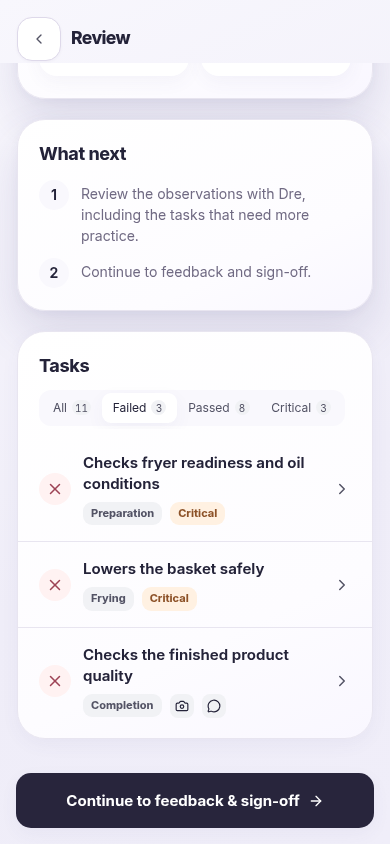
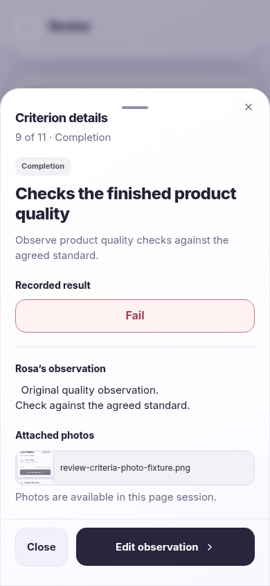

# Rosa Review — Criteria exploration

The existing React/shadcn Review now supports single-selection **All / Passed / Failed / Critical** filters and a read-only observation sheet. The assessment data, live response mechanism, summary, feedback, sign-off and V2–V4 stay intact.

## Shared components

`SpatialReviewList`, `SpatialReviewFilters`, `SpatialReviewCriterionRow` and `SpatialReviewDetails` live in `src/components/assessment/spatial-journey.tsx`. The actual components are mounted in Rosa and in the [Review story](https://lp-git-feat-rosa-criterion-guidance-hamaralpedro1988.vercel.app/?view=design-system&section=rosa&pattern=review).

- Counts and filtering use `src/data/spatial-review.ts`, the real criteria and existing evidence validation. Missing answers or required evidence appear as **Incomplete** and do not enter Passed/Failed filters. Critical includes any result.
- Clicking a row opens a shadcn Sheet. It shows the original instruction, criterion position, section/critical badges, read-only result and the original comment with whitespace preserved.
- Photos use the existing EvidencePanel gallery portal, object URLs, EvidenceAttachment and preview sheet. Review hides the removal action. No photo is copied into storage or simulated in the participant app; existing session-only media behavior is preserved.
- Escape, native/browser Back, Close and a downward drag on the handle dismiss the sheet. Focus returns to the row without scrolling it. The Review filter and scroll context remain mounted. Only **Edit observation** invokes the existing assessment navigation.
- Chips use native button keyboard behavior and `aria-pressed`; only one is selected. Horizontal overflow hides the scrollbar. Empty filters have neutral feedback.
- Sheet scrolling, device portal containment, safe areas, existing Spatial motion/reduced motion, semantic colors and branding tokens are reused.

## Mobile screenshots

Captured from the actual production React build using Chromium touch emulation. The QA image was attached through the actual file input; it is test evidence, not a submitted assessment.

| Width | Criteria filters | Detail sheet | Photos in the sheet |
| --- | --- | --- | --- |
| 320 px | [Widget](screenshots/criteria-320.png) | [Open sheet](screenshots/details-320.png) | [Photo area](screenshots/details-photos-320.png) |
| 390 px | [Widget](screenshots/criteria-390.png) | [Open sheet](screenshots/details-390.png) | [Photo area](screenshots/details-photos-390.png) |
| 419 px | [Widget](screenshots/criteria-419.png) | [Open sheet](screenshots/details-419.png) | [Photo area](screenshots/details-photos-419.png) |

## Verification

- `npm run build` passes.
- `npm test`: 33 tests pass, including mixed outcome/critical filtering and strict evidence completeness without mutations.
- `npm run lint`: only the three existing Fast Refresh warnings in button, badge and tabs.
- `scripts/check-spatial-review.py`: filters, counts, empty states, original note, real photo gallery/preview, read-only controls, keyboard, focus trap/restoration, browser Back, swipe-down, unchanged storage/filter, existing edit workflow and shared Explorer story at 320/390/419px.
- `scripts/check-spatial.py`: full journey, actual media, strict evidence, review/sign-off, persistence, offline/error, migrations, large text and V2–V4 at 320/375/390/419/1440px.

Physical-device testing was not available. Photos still clear on page reload; a restored criterion missing required photos correctly re-enters Incomplete until evidence is added through the existing live workflow.
